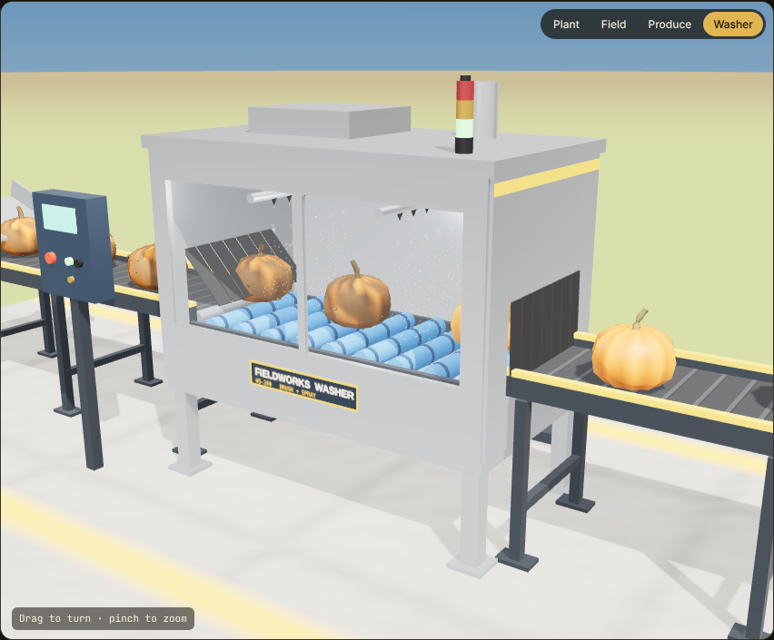

# Fieldworks crops and washing station

3D models for the Fieldworks farming phase: nine crops with five growth stages each, a dirty and a washed harvested item for every crop, and a washing station with conveyors.



## What's here

| Path | What it is |
|---|---|
| `models/fieldworks_<crop>.glb` | One file per crop: `<crop>_stage1` to `<crop>_stage5`, plus `<crop>_item_dirty` and `<crop>_item_washed` |
| `models/fieldworks_washing_station.glb` | Infeed conveyor, washer (brushes, spray bars, flaps, tank, pump, control panel, stack light), outfeed conveyor, crate on a pallet |
| `models/fieldworks_leaf_veins.png` | Leaf-vein texture shared by all crop models |
| `crops.js` | Generates every crop model, stage, condition and harvested item (three.js r147) |
| `station.js` | Generates the washing station and returns its moving parts for animation |
| `index.html` | Viewer: Plant, Field, Produce and Washer views |
| `tools/export-models.mjs` | Rebuilds the `.glb` files and the texture from `crops.js` and `station.js` |
| `images/` | Renders of each crop and the washer |

Crops: wheat, corn, carrot, tomato, watermelon, pumpkin, lettuce, cabbage, potato.

## Using the models in the game

- Units are metres. A plant's base sits at the origin; roots and tubers go below y = 0.
- Colours are stored as vertex colours. Plant materials should be double-sided.
- Apply `fieldworks_leaf_veins.png` as the colour map on the crop materials and set the material colour to 1.15 (the texture is slightly dark so the leaf veins can be lighter than the leaf).
- The wind sway and the crop conditions (dry, low nitrogen, disease) live in `crops.js` and the viewer's shader; the `.glb` files hold the healthy plants.
- Washed items look best with a lower roughness (about 0.5) than dirty ones (about 0.9).
- In the washing station, the belt top is at y = 0.8 m and produce flows along +x.

Triangles per plant at the last stage: wheat 460 per stem, corn about 1,700, carrot about 820, tomato about 4,150, watermelon about 2,200, pumpkin about 1,700, lettuce about 540, cabbage about 610, potato about 2,300.

## Viewing and rebuilding

Serve the folder with any static server and open `index.html`, for example `python -m http.server` and then `http://localhost:8000`.

To rebuild the models, install `three@0.147.0` and `pngjs@7.0.0` with npm, then run:

```
node tools/export-models.mjs crops.js station.js models
```
