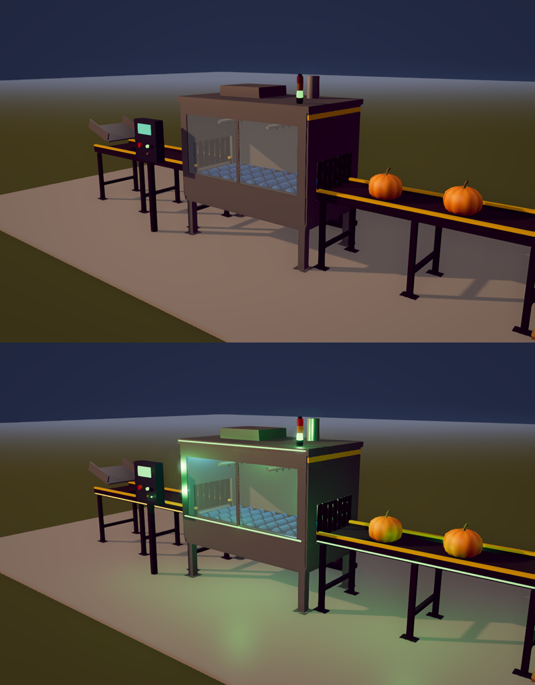

# Fieldworks glowing machines (graphics step 2)

`glow.js` gives machines lights that show what they're doing. It works on its own, and with `graphics.js` (step 1) the lights also bloom.



## The colour code (one for the whole game)

| State | Colour | Behaviour | Use it for |
|---|---|---|---|
| `running` | Green | steady | working normally |
| `waiting` | Amber | blinks once a second | out of input, output full, paused, waiting for the player |
| `stopped` | Red | steady | broken, no power, blocked, switched off by a fault |
| `flow` | Cyan | gentle pulse | water or power moving: pumps, sprinklers, live cables, irrigation |
| `off` | — | dark | machine turned off by the player |

A light always means something. Fences, tools and ordinary buildings don't glow.

## Parts

| Part | What it is |
|---|---|
| `stackLight` | Red, amber and green tower light; the segment for the current state lights up |
| `led` | Small indicator light; follows the state colour |
| `strip` | Glowing trim along an edge; follows the state colour |
| `screen` | Glowing display; can take a canvas texture (live screens come in step 4) |
| `headlight` | Vehicle headlight disc plus a real spot light; switch with `setHeadlights(on)` |
| `beacon` | Rotating amber warning beacon for vehicles; switch with `setBeacon(on)` |
| `adopt(mesh, kind, role)` | Turn a mesh the model already has (a lamp, a screen) into a glowing part |

**Light on nearby surfaces:**
- A fixed pool of real lights is handed each frame to the glowing parts closest to the camera, so a panel tints the metal and floor around it.
- **Pool size by effects quality:** high 8, medium 4, low 0 (glow only).
- **Why the pool size is fixed:** changing the number of lights would make three.js recompile shaders.

**Brightness:** parts are brighter than 1.0, so the bloom in `graphics.js` (threshold 1.4) picks them up. Sunlit surfaces stay below the threshold and don't bloom.

## Adding it to the game

```js
import { createGlow } from './glow.js';

const glow = createGlow({ scene, quality: 'high' });   // match gfx settings.effects

// Hand-placed parts on a hero machine (positions are in the machine's own space):
const washer = glow.attach(washerModel, { state: 'running' });
washer.stackLight({ position: new THREE.Vector3(0.7, 1.68, 0.35) });
washer.strip({ from: new THREE.Vector3(-0.86, 0.8, 0.52), to: new THREE.Vector3(0.86, 0.8, 0.52) });
washer.screen({ position: new THREE.Vector3(-1.25, 1.32, 0.79), width: 0.24, height: 0.12 });

// Any other machine, without placing parts by hand (stack light on top, strip along the front):
const mill = glow.autoFit(millModel, { state: 'waiting' });

// Vehicles:
const tractor = glow.attach(tractorModel);
tractor.headlight({ position: new THREE.Vector3(0.45, 1.1, 1.6), direction: new THREE.Vector3(0, 0, 1) });
tractor.headlight({ position: new THREE.Vector3(-0.45, 1.1, 1.6), direction: new THREE.Vector3(0, 0, 1) });
tractor.beacon({ position: new THREE.Vector3(0, 2.3, 0.2) });

// In the game loop, before gfx.render(dt):
glow.update(dt, camera);

// Wherever the game's own machine logic changes state:
washer.setState(hasInput ? 'running' : 'waiting');
pump.setState(pumping ? 'flow' : 'off');
generator.setState(fuel > 0 ? 'running' : 'stopped');
tractor.setHeadlights(isNight || inShed);

// When the effects quality setting changes:
glow.setQuality(settings.effects);   // 'low' | 'medium' | 'high'
```

**Which machines to hook up, and what decides their state:**

| Machine | State comes from |
|---|---|
| Washer, mill, furnace, processors | running / waiting (no input or output full) / stopped (fault) |
| Conveyors | running when moving, waiting when blocked |
| Sprinklers, pumps, irrigation | flow when water moves, waiting when the tank is empty |
| Generators | running, or stopped when out of fuel |
| Greenhouse | grow lights on as strips over the beds; flow while irrigating |
| Tractors, trucks | headlights at night and indoors; beacon while working a field or reversing |
| Late-game equipment | `attach(obj, { tier: 3 })` makes it glow more strongly |

## Tested so far

- **Test scene:** the washing line at dusk, using the step 1 pipeline on High. Infeed waiting (amber), washer and outfeed running (green), pump flowing (cyan), then the washer stopped (red). Renders are in `images/`.
- **Errors:** none in any state.
- **Not yet tested:** vehicle headlights and beacons, because there's no vehicle model in the test scene; and anything inside the real game.
