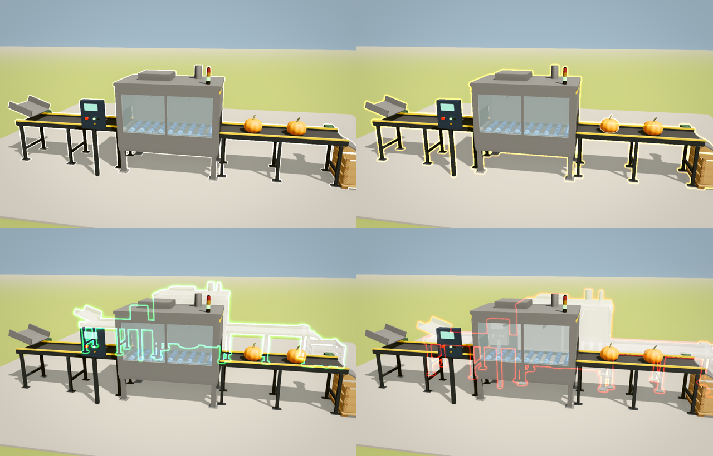

# Fieldworks interaction outlines (graphics step 3)

`outline.js` draws a clean outline that follows an object's real shape. It plugs into the `graphics.js` pipeline after tone mapping, so the colours on screen are exactly the ones set here.



*Top left: looking at the washer (subtle white). Top right: washer selected (amber), with a pumpkin hovered at the same time. Bottom left: placing a new line where it fits (green, pulsing). Bottom right: placing it where it doesn't fit (red, pulsing faster). The outline shows faintly through the machine in front, so you can see where the hidden parts of the new line will go.*

## States

| State | Look | When |
|---|---|---|
| `hover` | thin, soft white | the player looks at or walks up to something they can use |
| `select` | thicker amber with a slight glow, faint through walls | the object's menu is open, or it's chosen for moving or upgrading |
| `place` | thick green, slow pulse, shows through other objects | placement preview on a free spot |
| `blocked` | thick red, faster pulse | placement preview where it doesn't fit |

**Fading:** outlines fade in over about 0.1 s and out over about 0.15 s. When the player looks from one object to another, the old outline fades out while the new one fades in, using two hover passes.

**Cost when unused:** a state with nothing to draw is switched off. Each active outline renders only its own object plus a few small full-screen passes.

## Adding it to the game

```js
import { createOutlines } from './outline.js';

const outlines = createOutlines({ gfx, scene, camera });   // gfx from graphics.js

// Register everything the player can use: machines, vehicles, storage, doors, shop counters.
outlines.register(washerModel);
outlines.register(tractorModel);
outlines.register(chestModel);

// Every frame, before gfx.render(dt):
const target = outlines.pick({ reach: 4, player: player.position });  // aims from the screen centre
outlines.hover(target);
outlines.update(dt);

// When the player opens a machine's menu or picks it up to move:
outlines.select(washerModel);      // outlines.select(null) to clear

// While placing something (the ghost preview from the building system):
outlines.placing(ghostModel, canPlaceHere);   // true = green, false = red; outlines.placing(null) when done

// Keep in step with the pipeline:
gfx.resize(w, h); outlines.resize();
gfx.setCamera(cam); outlines.setCamera(cam);
outlines.setQuality(settings.effects);         // 'low' uses smaller outline buffers
```

**Picking:**
- **Pointer:** `pick()` aims from the screen centre for first-person play. Pass `pointer` (screen position from −1 to 1) to aim with the mouse instead.
- **Fallback:** if nothing is under the aim, it returns the nearest registered object in front of the player within reach. Walking up to a machine highlights it even if you're not looking straight at it.
- **Ignored:** unregistered objects (crops, trees, ground) are never outlined.
- **Removing:** when an object is deleted, call `outlines.unregister(obj)`.

## Tested so far

- **States:** all four, in the washing-line test scene with the step 1 pipeline on High; renders are in `images/outline_states.png`.
- **Picking:** aiming from the screen centre picked the washer as expected.
- **Errors:** none.
- **Not yet tested:** inside the real game, and with instanced objects. OutlinePass in three.js r147 doesn't outline `InstancedMesh` parts properly, so register machines and vehicles as ordinary meshes or groups. Crops are instanced, but they aren't meant to be outlined.
