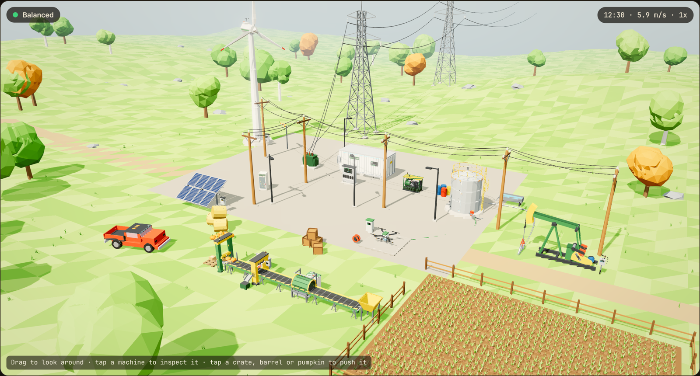
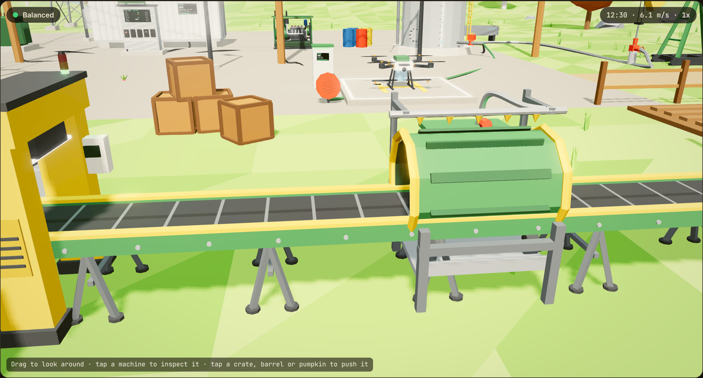

# Fieldworks power and water yard (low-poly)

`yard.html` is a playable low-poly yard where every machine works and depends on the others.

## What's in it

| Machine | Model and behaviour | Files |
|---|---|---|
| Wind turbine FW-WT20 | Tapered tower, nacelle that yaws into the wind, three twisted blades with pitch control, anemometer, windsock. Power rises with the cube of the wind up to rated output, then the blades pitch. It waits below 3 m/s and feathers and brakes above 24 m/s. | `yard.js` `windTurbine()`, `sims.js` `WindTurbine` |
| Solar array FW-SA8 | 8 modules on a torque tube, ballast feet, string inverter with a live screen. Output follows the sun angle, weather, cell temperature and dust. The level 3 tracker follows the sun. | `solarArray()`, `SolarArray` |
| Power network FW-GRID | Battery container (BESS), distribution panel with moving breaker handles and a flow screen, transformer, poles, cables and lattice towers. Renewables run first, then the battery, then the diesel set, which starts and stops on its own. Loads are shed in order (lights, drone charger, pump). Surplus is sold to the utility. | `batteryContainer()`, `distributionPanel()`, `transformer()`, `utilityPole()`, `latticeTower()`, `PowerGrid` |
| Diesel generator GX-12 | The existing engineered model in the low-poly style, used as automatic backup. | `generator.js` |
| Pump jack FW-PJ10 | Crank, pitman arms and walking beam solved as a real four-bar linkage; the horsehead arc lifts the rod straight up and down. Each stroke lifts the plunger volume from a 60 m well. | `pumpJack()`, `PumpJack` |
| Storage tank | 3 to 5 bolted rings (one per upgrade), cone roof with railing, ladder and cage, sight gauge with a float that tracks the level, manway, and a red outlet valve. | `storageTank()`, `StorageTank` |
| Spray drone FW-AD16 | Quad frame, spinning props, translucent tank with a liquid level, boom and spray mist, navigation lights. It refills from the tank, charges on the pad from the network, then sprays the field lane by lane and returns on an empty tank or low battery. | `sprayDrone()`, `dronePad()`, `sprayFX()`, `SprayDrone` |
| Crop field | Instanced low-poly plants; sprayed plants turn green and dry out over a few hours, which starts the next mission. | `cropField()` |
| Utility truck | Drivable on cannon-es raycast suspension: four springs, real mass, grip and brakes. Crates ride in the bed. | `truck()` plus the vehicle setup in `yard.html` |
| Physics props | Crates, barrels, pumpkins and hay bales with mass and friction; tap one to push it. Bodies sleep when still. The drone pushes props out of its way. | `crate()`, `barrel()`, `pumpkin()`, `hayBale()` |

World controls: time of day, simulation speed (1x, 10x, 60x), wind (calm to storm), weather (clear, cloudy, rain), and physics drops. Night uses its own colour grade and the yard lights only work while their circuit has power.

## Farm to sale (crops and the processing line)

| Part | What it does | Files |
|---|---|---|
| Crop field | Radish, carrot, wheat, cabbage, pumpkin or corn. Plants grow through four stages, but only while the soil is wet: the drone waters them. Ready plants are harvested into the hopper (automatically at 90% ready) and the field is replanted. | `lpcrops.js` `stages()`, `sims.js` `FieldSim` |
| Harvest hopper | Holds the harvest and feeds the belt. | `line.js` `bin()` |
| Conveyors | Green channel frame with yellow lips, end rollers, cleated belt (moves with the belt speed), A-frame legs, drive motor. | `conveyor()` |
| Drum washer | Slatted drum that turns on cradle rollers, spray bar, water tank with a sight glass. Each item uses 3 L from the yard's storage tank; with no water it passes unwashed and sells for 60%. | `washer()` |
| Optical sorter | Gantry with a camera head and light bars, brush diverter, reject chute and bin. Sorted produce sells for 25% more. | `cutter()` |
| Carton packer | Two towers and a carriage that folds and tapes each carton, with a magazine of flat cartons. Boxes stack on the pallet; a full pallet (12 boxes) is sold. | `packer()`, `pallet()`, `sims.js` `LineSim` |
| Extras | Stainless sink station and a drinks cooler (lit when the lights circuit has power). | `washTable()`, `vendingMachine()` |

The line has its own breaker on the distribution panel and is shed second when power runs short (after the lights).
Harvested items come from `lpcrops.js` `item(crop, dirty)`: each one turns from dirty to clean as it leaves the washer.

## Look and sharpness

- No ink outlines by default (`STYLE.outline` in `lowpoly.js`); clean faceted shapes with matte colours.
- The page renders at the screen's full resolution (up to 2x). Automatic downscaling stays off on computers, and on phones it never goes below 85%.

## Farming cycle, bakery chain, buildings and saving

| Part | What it does | Files |
|---|---|---|
| 14 crops, 7 stages | Radish, carrot, potato, tomato, lettuce, cabbage, wheat, rice, corn, cotton, sunflower, soybean, strawberry and pumpkin. Each goes seed, sprout, young, growing, mature, ready, harvested (stubble). Plowed soil shows as clods. | `lpcrops.js` `stages()`, `item()`, `tilledGeo()` |
| Field | Soil states: growing, harvested stubble, plowed. The crop in the ground stays until the field is sown again; the crop picker sets the next sowing. | `sims.js` `FieldSim` |
| Tractor FW-T120 | Backs onto an implement until the hitch ports line up, couples it through the connection system, drives the field lane by lane, then parks the implement. Plow (stubble to plowed), seeder (plowed to sown) and harvester (ripe to stubble, collected in a bin and tipped into the line hopper). Auto farming runs the whole cycle. Uses diesel, wears, can be upgraded. | `farm.js`, `sims.js` `TractorSim` |
| Bakery chain | The optical sorter diverts wheat and corn onto a grain conveyor. The stone mill turns 2 sheaves into a sack of flour (corn makes cornmeal), the tunnel oven bakes flour into bread, the bagger packs 4 per crate, and a full pallet of 12 crates is sold. Runs on the line circuit. | `food.js`, `sims.js` `ChainSim` |
| Buildings | Barn, warehouse and greenhouse with slabs, closed walls, full roofs and doors. Place them with a ghost preview that snaps to a 0.5 m grid, turns 90° with R, and shows red with the reason when blocked (field, line, slots, other objects, yard edge). They get colliders and can be removed for half the price. | `buildings.js` |
| Saving | Autosaves every 30 s and when the page is hidden. The previous save is kept as a backup and used if the main one fails to read. Saved: money, time, all upgrade levels and conditions, tank, battery, generator fuel, every plant, the line and chain totals, tractor fuel and buildings. "New farm" clears it. | `yard.html` |

The validator (`yard.html?audit=1`) covers all of these models: 0 errors, 0 warnings, 61 connections.

## The low-poly style (`lowpoly.js`)

- `stylize(root)`: flat-shaded materials, photo maps removed, canvas screens and labels kept, and outlines made from inverted hulls with smoothed normals. Outlines stay at least about 1.3 px wide at any distance.
- `bake(root, keep)`: merges every part that does not move into one mesh per material. The yard went from about 2,200 draw calls to about 470. Run it before `stylize()`, and list the parts that animate in `keep`.
- `tree()`, `rock()`, `grassTuft()`, `terrain()`, `terrainHeight()`: nature and ground.

## Putting it into the game

1. Copy `lowpoly.js`, `yard.js` and `sims.js` next to the existing machine files (`machine.js`, `parts.js`, `generator.js`, `graphics.js`, `glow.js`, `outline.js`).
2. Build a machine, then `bake()` (the builders already bake themselves), then `stylize()`, then attach glow lights. Glow must come after `stylize()`, because `stylize()` replaces materials.
3. Each frame call the sim's `tick(dt, env)` and the model's `animate(dt, sim, env)`. `env` is `{ hour, sunDir, irradiance, wind, windDir, airC }`.
4. Panels use the same `panel()` and `act(id, wallet)` format as the wash line.
5. cannon-es (0.20.0) runs the physics. After you place or rotate a static body, call `body.updateAABB()`. Without it, raycasts (and so the truck's wheels) miss the body.
